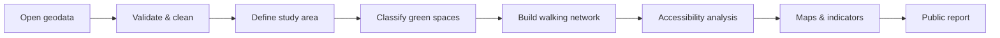

<div align="center">

# 🌳 GreenSpace Kolding
### Mapping access to urban green spaces in Kolding, Denmark

**Open-source GIS · Spatial analysis · Urban planning · Reproducible research**


*An independent portfolio project — not an official Kolding Municipality analysis.*

</div>

---

## 🎯 Project overview

**Research question:** How accessible are public green spaces from residential areas in Kolding, and where are potential gaps in access?

GreenSpace Kolding aims to develop a transparent, reproducible geospatial workflow that maps green spaces, measures walking accessibility and communicates spatial patterns through maps and a public project website.

> **Current stage:** Project setup. No analytical findings are published yet.

## 🗺️ Planned outputs

| Deliverable | Description | Status |
|---|---|---|
| Green-space inventory | Classified and quality-checked spatial dataset | Planned |
| Baseline map | Map of selected green spaces within the study area | Planned |
| Accessibility analysis | Walking-network distances to accessible green spaces | Planned |
| Summary indicators | Coverage at 300 m, 500 m and 1,000 m | Planned |
| Interactive web map | Public map and interpretation of results | Planned |
| Methods and limitations | Reproducible scripts, provenance and caveats | Planned |

**Note:** The distance thresholds are exploratory choices, not asserted municipal standards. Final indicators depend on data suitability.

## 🔁 Analytical workflow



## 🧰 Technology stack

- **QGIS:** geodata inspection, geoprocessing and cartographic quality control
- **Python:** reproducible processing and analysis (planned: GeoPandas, Shapely, NetworkX)
- **Git + GitHub:** version control, issues, pull requests and releases
- **GitHub Projects:** Kanban workflow and prioritized product backlog
- **GitHub Actions:** automated checks and tests
- **GitHub Pages:** public presentation of results

Dependencies will be pinned once the implementation is established.

## 📍 Study area and data

The study area will cover **Kolding urban area**, using an explicitly documented boundary rather than assuming that the municipal boundary represents the city.

Candidate sources (subject to review):

- [Dataforsyningen](https://dataforsyningen.dk/) — Danish geospatial reference data
- [GeoDanmark](https://www.geodanmark.dk/) — topographic features
- [OpenStreetMap](https://www.openstreetmap.org/) — potential paths, pedestrian links and green-space features
- [Statistics Denmark](https://www.statbank.dk/) — potential population indicators, if suitable spatial resolution and usage terms are available

For each dataset, the project will record its **source, acquisition date, license, coordinate reference system, processing steps and limitations**. Restricted or oversized raw datasets will not be committed to the repository.

## 🧪 Methodology (planned)

1. Establish a defensible urban study boundary.
2. Define what counts as an accessible green space, including public access and entrances.
3. Acquire, harmonize and validate spatial layers.
4. Build a pedestrian network and calculate walking distances.
5. Summarize accessibility by appropriate residential units.
6. Produce maps, descriptive indicators and uncertainty notes.

Straight-line distances will not be presented as walking distances. Areas without reliable entrance or path data will be flagged rather than silently treated as accessible.

## 📌 Project management

Work is managed using a lightweight **Agile / Kanban** approach:

`Backlog → Ready → In Progress → Review → Done`

### Proposed milestones

| Milestone | Scope | Target |
|---|---|---|
| M0 · Initialization | Repository, issues, tooling and governance | 16 Oct 2026 |
| M1 · Data acquisition | Boundary, data inventory and validation | 23 Oct 2026 |
| M2 · Baseline GIS | Green-space classification and first map | 30 Oct 2026 |
| M3 · Accessibility | Network-based analysis and indicators | 6 Nov 2026 |
| M4 · Publication | Interactive map and documentation | 20 Nov 2026 |
| M5 · v1.0 release | Review, tests and public presentation | 27 Nov 2026 |

These are **planned milestones**, not completed work. See the repository's **Issues** and **Projects** tabs once configured.

### Definition of Done

An issue is complete when its acceptance criteria are met, relevant tests pass, data provenance and limitations are documented, and the change has been reviewed and merged.

## 📂 Proposed repository layout

```text
greenspace-kolding/
├── .github/           # workflows and issue templates
├── data/              # metadata and reproducible data instructions
├── docs/              # methodology and project website
├── maps/              # exported cartography
├── notebooks/         # exploratory analysis
├── src/greenspace/    # reusable analysis code
├── tests/             # automated tests
└── README.md
```

## 🚀 Getting started

The implementation is under development. Once the environment and ingestion pipeline are available, this section will include verified setup commands and a minimal reproducible example. **Do not assume the planned workflow is already executable.**

## 📊 Results

*No results yet.* This section will be updated with validated maps, figures, and clearly stated findings. A future interactive map will be linked here.

## ⚠️ Limitations and interpretation

This is an independent demonstration project. The presence of a mapped green polygon does not automatically imply public access, usable entrances, high ecological quality or recreational suitability. Accessibility is not equivalent to actual usage or perceived safety. Conclusions will be qualified by the completeness and dates of the underlying datasets.

## 🤝 Contributing

Suggestions and reproducible bug reports are welcome through GitHub Issues after the repository is published. Contributions should document assumptions and respect dataset licenses.

## 📜 Licensing and attribution

The code license will be selected and added before the first public release. **Data retain their original licenses and attribution requirements.** Do not assume that the code license applies to third-party datasets.

---

<div align="center">

**GreenSpace Kolding** · Geospatial analysis for clearer urban planning decisions

*Project status: planning and initial setup · October 2026*

</div>
